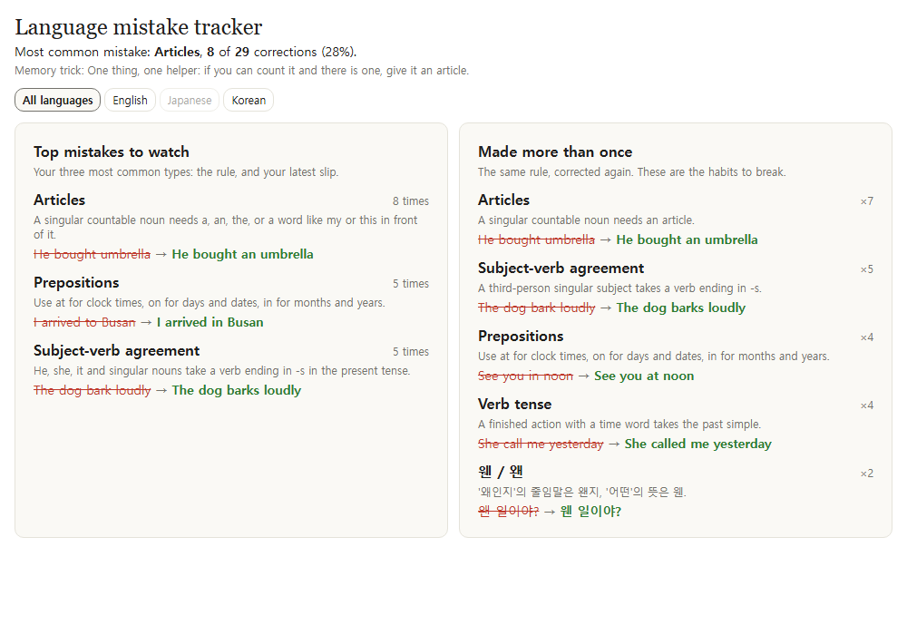
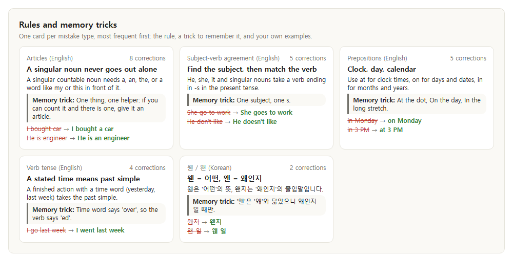
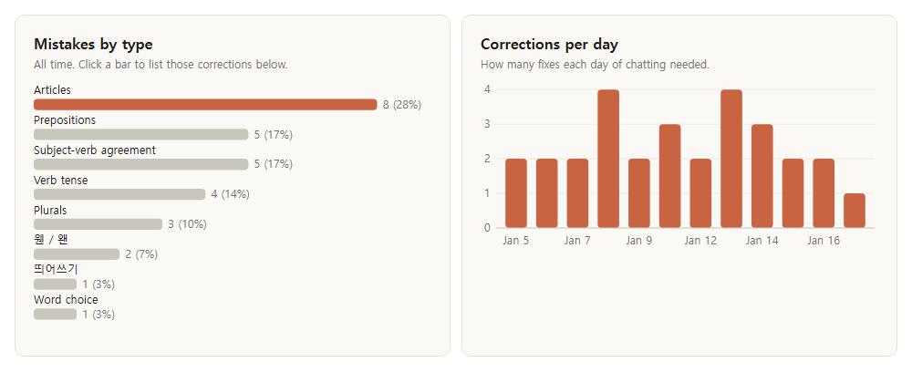
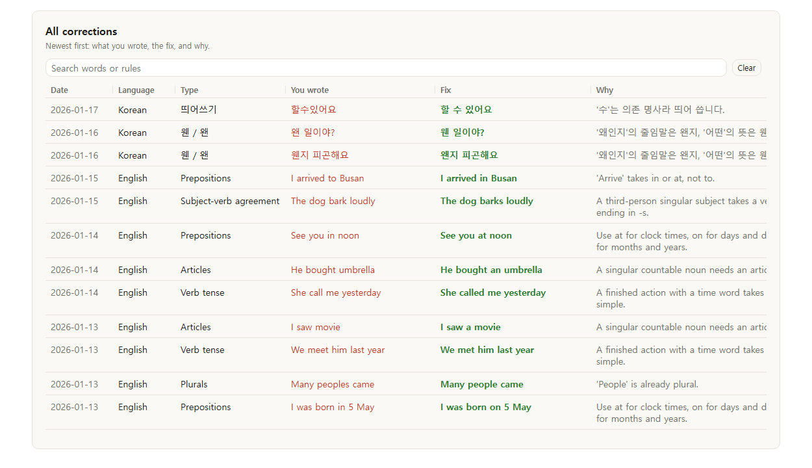
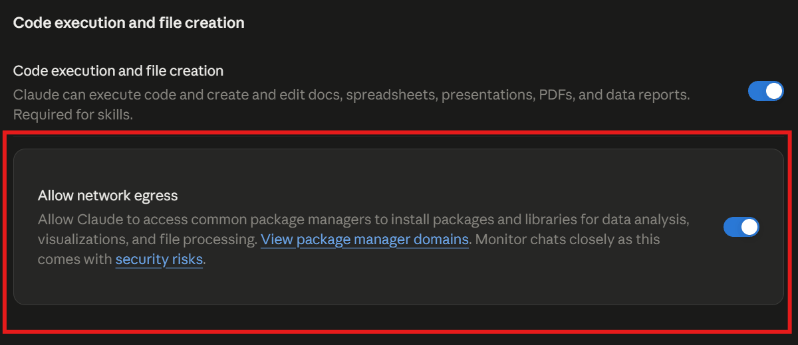

# Language mistake tracker

[English](README.md) | **한국어**

**대화할 때마다 Claude가 고쳐 주는 실수를 복습 자료로 만들어 줍니다.**

Claude가 대화 중에 고쳐 준 외국어 실수를 모아 복습 자료로 만들어 주는 Claude 대시보드입니다. 자주 하는 실수 유형, 반복되는 습관, 규칙과 외우는 요령, 전체 교정 목록(검색 가능)을 한 화면에서 봅니다.

구성은 두 가지입니다.

- **대시보드** (`dashboard/`): 교정 내역을 보여 주는 Claude 대시보드 아티팩트
- **스킬** (`skill/language-coach/`): 모든 대화에서 Claude가 내 문장을 교정하고, 교정 내역을 대시보드에 기록하게 하는 스킬

## 미리보기

몇 번 대화한 뒤 보게 되는 화면입니다 (예시 데이터).









스크린샷은 가상의 예시 데이터입니다.

## 설치와 업데이트 (Claude 앱에서, 폰도 가능)

### 준비 (처음 한 번만)

1. **브라우저**(앱 말고)로 [claude.ai 설정 → 기능(Capabilities)](https://claude.ai/settings/capabilities)을 열어요. 로그인이 안 되어 있으면 먼저 로그인하세요.
2. **코드 실행 및 파일 생성** 켜기
3. **네트워크 허용(Allow network egress)** 켜기
   - 이 항목은 **앱 설정에는 없어요.** 브라우저에서 켜야 해요. 한 번 켜면 앱에도 그대로 적용돼요.
   - 계정에 따라 기본으로 꺼져 있어요.
4. 앱으로 돌아와 **새 대화**를 열어서 진행하세요. 이미 열려 있던 대화에는 바뀐 설정이 적용되지 않아요.
5. 새 대화에서도 막히면 **설정이 반영되기까지 몇 분** 걸릴 수 있어요. 5분쯤 뒤에 다시 시도하세요.



### 설치

새 대화에 아래 문구를 그대로 붙여 넣으세요.

```
https://github.com/wonjoonSeol-WS/language-mistake-tracker 의 INSTALL.md를 따라 설치해 줘
```

Claude가 대시보드를 만들고 language-coach 스킬을 Claude 계정에 추가해 줘요. 계정에 추가된 스킬은 Claude 앱과 Claude Code 모두에서 동작해요. Claude가 알려 준 대시보드 링크를 열어 보세요. Claude가 스킬을 직접 추가하지 못하면 `language-coach.zip`을 주니, **Settings > Customize > Skills**에서 올리면 돼요.

잘 되는지 보려면 `She go to work yesterday`처럼 틀린 문장을 보내 보세요. 답변 끝에 **Language fixes** 항목이 붙고, 대시보드를 새로 고치면 새 기록이 보여요.

### 업데이트

교정 기록은 대시보드 링크에 묶여 있어요. **새 대시보드는 빈 상태로 시작**하니, 업데이트는 항상 쓰던 대시보드에 덮어써야 해요. 마지막 줄의 링크를 내 대시보드 주소로 바꿔서 보내세요.

```
https://github.com/wonjoonSeol-WS/language-mistake-tracker 의 INSTALL.md에 있는 "Updating" 절차대로 내 Language mistake tracker를 업데이트해 줘.
내 대시보드: (여기에 내 대시보드 링크 붙여 넣기)
```

Claude가 대시보드 화면과 스킬을 새 버전으로 바꿔 줘요. 교정 기록과 가이드는 그대로 남아요.

### 스킬만, Claude Code 플러그인으로

대시보드가 이미 있다면 Claude Code에서 스킬만 추가합니다.

```
/plugin marketplace add wonjoonSeol-WS/language-mistake-tracker
/plugin install language-coach@language-mistake-tracker
```

스킬은 대시보드를 제목 `Language mistake tracker`로 찾으니 이름을 바꾸지 마세요. 기본은 영어 교정이며, Claude에게 "한국어도 배우고 있어"라고 말하면 기억합니다. 대시보드가 없으면 교정만 해 주니, 위의 설치 프롬프트로 먼저 만드세요.

## 직접 설치 (Claude Code)

### 1. 대시보드 만들기

Claude 앱과 같은 계정으로 로그인한 Claude Code가 필요합니다.

```sh
git clone https://github.com/wonjoonSeol-WS/language-mistake-tracker.git
cd language-mistake-tracker
claude
```

그다음 Claude에게 이렇게 요청합니다.

> 이 저장소로 "Language mistake tracker"라는 새 Dashboard 아티팩트를 만들어 줘. `examples/corrections.example.csv`와 `examples/guides.example.json`을 파일로 올리고, `dashboard/meta.json`, `dashboard/params.json`, `dashboard/datasets/*.json`(올린 파일 URL 반영)을 저장소에 쓰고, `dashboard/files/`의 모든 파일을 `files/<이름>`으로 써 줘.

Claude가 대시보드 링크(`https://claude.ai/artifact/...`)를 알려 줍니다. 열면 대시보드가 보입니다.

빈 상태로 시작하려면 예시 CSV에서 첫 줄(헤더)만 남기면 됩니다. 예시 가이드는 그대로 둬도 되고, 아직 교정 기록이 없는 가이드는 "Flagged by you"로 표시됩니다.

| 저장소 문서 | 원본 |
|---|---|
| `dash/meta` | `dashboard/meta.json` |
| `dash/params` | `dashboard/params.json` |
| `datasets/corrections`, `datasets/guides` | `dashboard/datasets/*.json` (`source.url`은 올린 파일 주소로) |
| `files/<이름>` (`{"text": ...}`) | `dashboard/files/<이름>` |

### 2. 모든 대화에서 켜기

1. 스킬을 Claude 계정에 추가합니다. `skill/language-coach` 폴더를 zip으로 묶어 Claude 앱의 **Settings > Customize > Skills**에서 업로드합니다. 계정에 올린 스킬은 Claude Code에도 동기화됩니다(`~/.claude/skills/synced/` 아래에 보입니다). Claude Code에서만 쓰려면 대신 폴더를 `~/.claude/skills/language-coach/`로 복사합니다.
2. Claude가 필요하다고 판단할 때만이 아니라 매 메시지마다 동작하게 합니다.
   - Claude 앱: **Settings > Profile**의 개인 선호(personal preferences)에 다음 문장을 추가합니다. `When I write in English, use the language-coach skill to correct my mistakes and log them.`
   - Claude Code: 같은 문장을 `~/.claude/CLAUDE.md`에 추가합니다.
   - 영어 말고 다른 언어도 배우나요? 그 문장에 언어를 넣으세요. 예: `When I write in English or Korean, ...`

메뉴 이름은 요금제와 앱 버전에 따라 다를 수 있습니다. Team, Enterprise 요금제에서는 관리자가 사용자 스킬을 허용해야 할 수 있습니다.

### 3. 동작 확인

`She go to work yesterday`처럼 틀린 문장을 보내 봅니다. 답변 끝에 **Language fixes** 항목이 붙고, 대시보드를 새로 고치면 새 교정 기록이 보이면 정상입니다.

## 폴더 구조

```
dashboard/
  meta.json, params.json   대시보드 제목, 기본 언어 필터
  datasets/                교정 기록과 가이드 파일을 어디서 읽는지
  files/
    index.html             마크업. 아래 스타일과 스크립트를 순서대로 불러옴
    styles.css
    calcs.js               파생 데이터셋 (개수, 순위, 일별, 합계, 반복)
    shared.js              window.LMT: 모든 패널이 쓰는 포맷터와 DOM 헬퍼
    header.js              언어 버튼, 상단 수치, 외우는 요령
    review.js              자주 하는 실수, 반복 실수, 가이드 카드
    charts.js              유형별, 일별 차트
    table.js               교정 목록 표: 열, 너비 조절, 검색, 유형 필터
skill/language-coach/      교정 및 기록 스킬
INSTALL.md                 Claude가 따라 하는 설치 절차
examples/                  예시 교정 기록과 가이드
docs/images/               README 스크린샷
data/                      내 데이터 (git에서 제외)
```

## 페이지 동작 방식

이 페이지는 단독 HTML이 아니라 Claude 대시보드 안에서 실행됩니다. 대시보드가 `dash`(데이터 로딩, 파생 데이터셋, 필터), `d3` v7, `--color-fg` 같은 테마 변수를 제공합니다. 스크립트는 파일마다 별도 스코프에서 실행되므로, 파일 간 공유 코드는 `window.LMT`를 통하고, 패널 파일마다 자기 `dash.onData` 다시 그리기를 등록합니다.

모든 차트와 수치는 아래 파생 데이터셋에서 나옵니다.

| calc | 입력 | 내용 |
|---|---|---|
| `scoped` | corrections | 각 교정을 `scope` = 해당 언어, `scope` = `All`로 두 번씩. 빈 언어는 English, `day`는 `YYYY-MM-DD` |
| `by_category` | scoped | (scope, 유형)별 개수, 비율, 순위, 최근 예시 |
| `by_day` | scoped | (scope, 날짜)별 교정 수 |
| `totals` | scoped | scope별 총 교정 수, 유형 수, 기록한 날 수, 시작일 |
| `repeats` | scoped | scope별로 두 번 이상 교정받은 규칙 |

언어 버튼은 `language` 필터를 바꾸고, 모든 패널은 `scope`가 그 값과 같은 행만 보여 주므로 `All`에 특별 처리가 필요 없습니다. calc 함수는 읽는 사람에게 소스가 그대로 보이기 때문에 외부 헬퍼 없이 자기 완결적이어야 합니다. 그래서 공통 정규화는 헬퍼 대신 `scoped`에 있습니다.

## 데이터 형식

`corrections.csv`: `id,date,language,category,original,corrected,rule`. 반복 여부는 언어, 유형, 규칙 문구가 같은지로 판단하므로, 같은 실수에는 규칙 문구를 그대로 다시 씁니다.

`guides.json`: `{id, language, category, title, rule, mnemonic, examples}` 배열. `examples`는 `"틀린 문장 → 고친 문장 | 틀린 문장 → 고친 문장"` 형식입니다.
